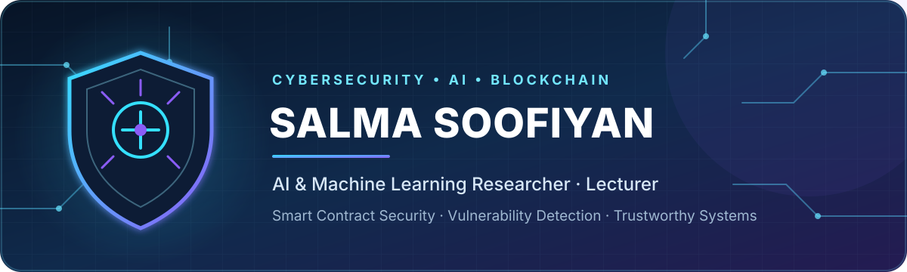

  

  <strong>Lecturer and researcher at the University of East London</strong> 
  Smart contract security · Applied machine learning · FinTech risk

  <a href="https://www.linkedin.com/in/salma-soofiyan-92033011b/">LinkedIn</a> ·
  <a href="mailto:salma.soofiyan@gmail.com">Email</a> ·
  <a href="https://github.com/salmasoo88?tab=repositories">Repositories</a> ·
  <a href="https://github.com/salmasoo88?tab=overview#contribution-activity">GitHub activity</a>

I study how to detect vulnerabilities in Ethereum smart contracts and how to turn those findings into deployment decisions. I also teach and supervise postgraduate research in cybersecurity, AI, data science and blockchain.

## GitHub activity

  

  

## Research in focus

| Focus | What I work on |
| :--- | :--- |
| **Smart contract security** | Static, semantic and structural analysis of Ethereum contracts, and policy checks before deployment |
| **AI for cybersecurity** | Machine learning for anomaly, intrusion and fraud detection, with an emphasis on evaluation and explainability |
| **Blockchain and FinTech** | Oracle reliability, lending risk and governance controls in decentralised finance |

## Selected publications

- **Ethereum smart contracts: a hierarchical analysis of vulnerability challenges and mitigation strategies** · *Cluster Computing*, 2025. [Read the article](https://doi.org/10.1007/s10586-025-05173-8)
- **Beyond Detection: Policy-Driven Dynamic Deployment Gating for Smart Contracts** · Conference contribution, 2026.
- **Enhancing Smart Contract Security: Static Heuristics and CodeBERT Embeddings** · Conference paper, 2025.

<strong>More publications and manuscripts</strong>

- **S3-Guard: Semantic, Static, and Structural Guard for Smart Contracts** · *IET Blockchain*, forthcoming.
- **Uncertainty-Certified Economic Control for Smart Contract Deployment** · Under review.
- **Innovative Health Technology Assessment Tools** · *Medical Oncology Compendium*, Elsevier, 2025.

## Current research

- **Smart contract deployment gating** · Studying how explicit security policies can use vulnerability findings to guide release decisions.
- **DeFi lending stress tests** · Studying how oracle delays, governance timing and market depth affect simulated lending risk.
- **Security evaluation** · Reassessing how evaluation design and data choices affect vulnerability detection results.

<strong>Tools and methods</strong>

### Languages

### Security, Blockchain & Data

<strong>Teaching, experience and education</strong>

- **AI & Machine Learning Researcher / Lecturer** — University of East London, 2021–Present
- **Web Developer** — University of East London, 2021–2023
- **Lecturer** — Payam-E-Noor University & University of Elmi Karbordi, 2015–2019
- **Volunteer Instructor** — Behzisti Welfare Organization, 2013–2015

### Education

- **PhD in Computer Science** — University of East London, 2023–2026  
  *AI-driven cybersecurity, Ethereum smart contract vulnerability detection, and blockchain security*
- **MSc in Computer Science (Artificial Intelligence)** — University of East London, 2020–2021
- **MSc in Mechatronics Engineering** — Islamic Azad University of Tehran, 2012–2015
- **BSc in Electrical & Electronics Engineering** — Islamic Azad University of Tehran, 2007–2011

<strong>Speaking, awards and certifications</strong>

- 🏆 Outstanding Long Service Award — University of East London
- 🎤 Invited international speaker — 23rd Brazilian Congress of Cancerology
- 📝 Invited academic peer reviewer — ICASA Conference
- 👑 Selected to present project work to **King Charles III** during UEL's 100-year anniversary
- ☁️ Microsoft Certified: **Azure AI Fundamentals**
- 🔗 Completed the **Chainlink Smart Contracts / Web3 Bootcamp**

